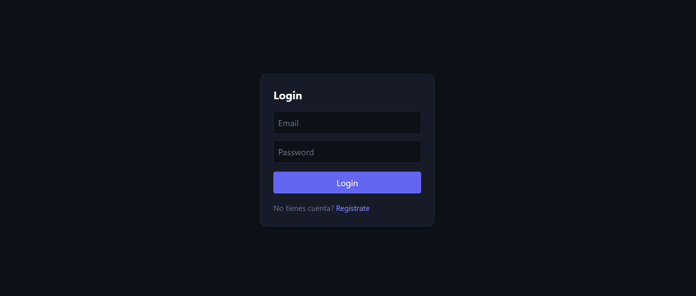
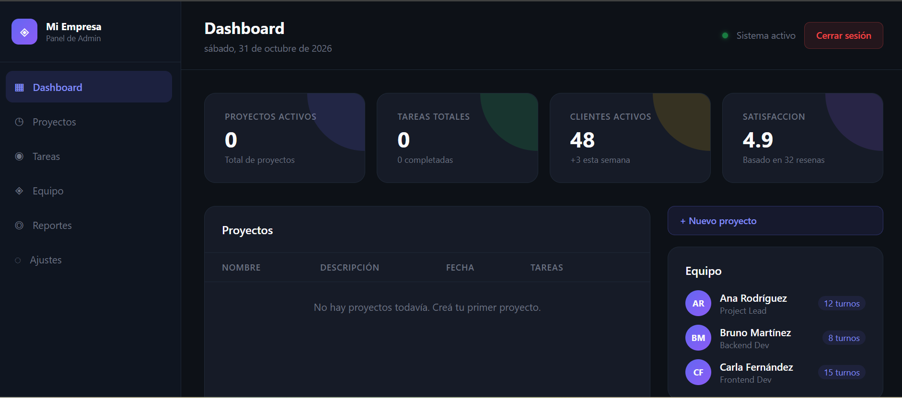
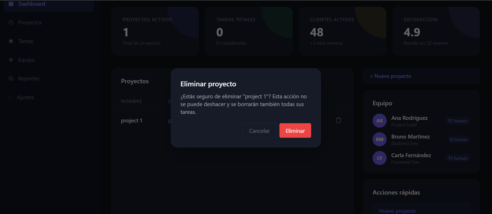

# Admin Dashboard SaaS

A full-stack project management dashboard: JWT authentication, per-user data isolation, and a typed React frontend backed by an Express + Prisma + PostgreSQL API.

Built as a portfolio project to practise production-style patterns — layered backend, schema-driven validation, server-state caching, fail-fast configuration, and automated tests for the authorization rules.

**[Live demo](https://dashboard-admin-saas.vercel.app)** · **[60-second video walkthrough](https://www.loom.com/share/7b1118cf17494919bff718f343991f9e)**

> No demo credentials needed: open the live demo and create an account from the *Register* page (any email works).

> The API runs on Render's free tier, so the first request after a period of inactivity can take up to a minute while the server wakes up. After that it responds normally.

## Screenshots

| Login | Dashboard |
|-------|-----------|
|  |  |

Destructive actions ask for confirmation first:



## Features

- Email/password registration and login (bcrypt + JWT)
- Protected routes with redirect-after-login
- Projects CRUD, **scoped per user**: nobody can list or delete another user's data
- Confirmation dialog for destructive actions
- Server-state caching with automatic invalidation after mutations (no manual refresh)
- Global 401 handling: an expired token logs the user out and redirects to login
- Cross-tab session sync (log out in one tab, every tab follows)
- Responsive layout with a collapsible sidebar and a dark theme
- Request validation on both sides with Zod (client forms and API bodies)

## Tech stack

| Layer | Technologies |
|-------|--------------|
| Frontend | React 19, TypeScript, Vite, Tailwind CSS v4, React Router v7, TanStack Query v5, React Hook Form + Zod |
| Backend | Node.js, Express 5, Prisma ORM, PostgreSQL, bcrypt, jsonwebtoken, Zod |
| Testing | Node's built-in test runner (`node --test`), in-memory Prisma fake |
| Deployment | Vercel (frontend), Render (API) |

## Architecture decisions

**Layered backend.** Routes only wire up middleware, controllers handle HTTP concerns (status codes, parsing), services hold business logic and talk to Prisma. Services know nothing about HTTP, which keeps them easy to test.

**Authorization scoped per user.** Every query touching `Project` filters by the authenticated user's id, taken from the verified JWT and never from the request body. Deleting uses `deleteMany` with a compound `where` (`id` + `userId`): if the project belongs to someone else it matches zero rows and the API answers `404`, without revealing that the project exists.

**No user enumeration.** Login answers `401 Invalid credentials` for both an unknown email and a wrong password, so the endpoint can't be used to discover registered emails.

**Server state vs UI state.** Projects live in TanStack Query (caching, deduplication, background refetch). Local UI state — sidebar, modals — stays in `useState`.

**Schema-driven validation.** Zod schemas validate forms through `@hookform/resolvers` and validate request bodies on the API through a small `validate(schema)` middleware. Rules are kept identical on both sides.

**Fail-fast configuration.** Backend and frontend read environment variables in a single module and throw at startup if a required one is missing, instead of failing later with a confusing error.

## Testing

```bash
cd crm-saas-backend
npm test
```

25 tests run the real Express app (routes, middlewares, controllers, services) against an in-memory Prisma fake, so they need no database. They cover:

- JWT middleware: missing token and invalid token both return `401`
- A user only lists their own projects
- A client cannot assign a new project to another user by sending a `userId` in the body
- Deleting another user's project returns `404` and leaves it untouched
- Input validation returns `400` before reaching the database
- Login returns a valid JWT, and gives the same error for unknown email and wrong password
- Passwords are stored as bcrypt hashes; duplicate emails are rejected

Authorization tests were checked by deliberately removing the ownership filter and confirming that they fail.

## Getting started

**Prerequisites:** Node.js 20+, npm, PostgreSQL 14+ (local or hosted — Neon, Supabase and Railway all work).

### Backend

```bash
cd crm-saas-backend
npm install

cp .env.example .env
# Edit .env: set DATABASE_URL and JWT_SECRET
# Generate a secret with: node -e "console.log(require('crypto').randomBytes(32).toString('hex'))"

npx prisma migrate dev   # create the tables
npm run dev              # http://localhost:3001
```

### Frontend

```bash
cd crm-saas-frontend
npm install

cp .env.example .env.local
# VITE_API_URL=http://localhost:3001/api

npm run dev              # http://localhost:5173
```

### Environment variables

**Backend (`.env`)**

| Variable | Required | Description |
|----------|----------|-------------|
| `DATABASE_URL` | Yes | PostgreSQL connection string |
| `JWT_SECRET` | Yes | Secret used to sign tokens (32+ random bytes) |
| `JWT_EXPIRES_IN` | No | Token lifetime (default `1d`) |
| `PORT` | No | Server port (default `3001`) |

**Frontend (`.env.local`)**

| Variable | Required | Description |
|----------|----------|-------------|
| `VITE_API_URL` | Yes | Backend API base URL |

## Project structure

```
├── crm-saas-backend/
│   ├── prisma/schema.prisma      # User, Project, Task models
│   ├── src/
│   │   ├── config/               # env validation, Prisma client
│   │   ├── routes/               # Express routers
│   │   ├── middlewares/          # JWT auth, Zod validation
│   │   ├── controllers/          # HTTP layer
│   │   ├── services/             # business logic
│   │   └── schemas/              # Zod request schemas
│   └── tests/                    # API and authorization tests
└── crm-saas-frontend/
    └── src/
        ├── auth/                 # AuthProvider, useAuth, ProtectedRoute
        ├── components/dashboard/ # Sidebar, TopBar, ProjectsTable, ...
        ├── hooks/                # useProjects, useCreateProject, useDeleteProject
        ├── lib/                  # API client, env validation
        ├── pages/                # Login, Register, Dashboard
        └── schemas/              # Zod form schemas
```

## Known limitations

This is a learning project, and a few parts are intentionally unfinished:

- Real data: authentication and projects. Sample data: the sidebar entries, the team panel, quick actions, and the "active clients" and "satisfaction" cards are static placeholders (see `src/data/mockData.ts`).
- Tasks exist in the database schema and API, but there is no tasks UI yet.
- The backend is JavaScript while the frontend is TypeScript.
- No frontend tests yet.

## Roadmap

- [x] Backend request validation with Zod
- [x] Global 401 handling
- [x] Deployment (Vercel + Render)
- [x] Backend authorization and auth test suite
- [ ] Tasks CRUD with ownership checks, plus UI
- [ ] Replace the sample data with real endpoints
- [ ] Migrate the backend to TypeScript and share Zod schemas with the frontend
- [ ] Frontend tests (Vitest + React Testing Library)
- [ ] Workspaces: multiple users per organization
- [ ] Stripe billing

## License

MIT

## About

Built by [Juan Segundo Arceluz](https://github.com/juansegundoarceluz), a full-stack developer based in Australia and open to work. Feedback is welcome.
